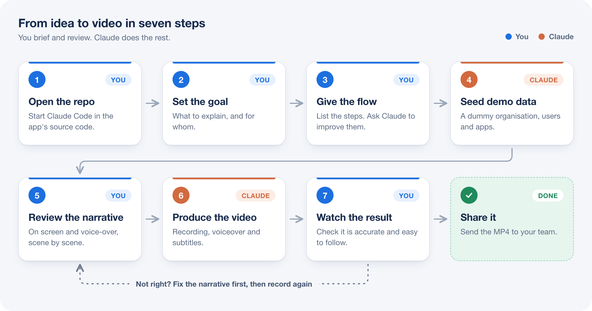
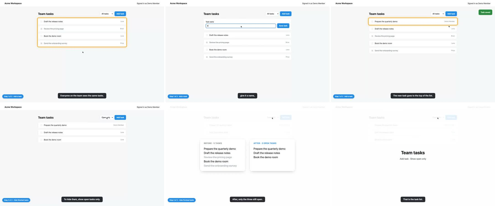

# walkthrough-video

An agent skill that makes narrated walkthrough videos of a web app. You describe what the video should explain; the agent runs the app, writes the script, records the screen, adds an AI voiceover and subtitles, and hands you an MP4.

No screen-sharing takes and no editing software. You review the script before it records and the video after.



## What you get

- A 1440×900 MP4 of the real app, with voiceover normalised for laptop speakers
- A visible cursor, a highlight ring on the control being discussed, a step label and burned-in subtitles
- Before/after cards for moments where a setting changes what someone sees
- A matching `.srt` file and the reviewed script, so the next revision is a small edit

## Install

With the [skills CLI](https://skills.sh):

```bash
npx skills add adityaleksono/walkthrough-video-skill
```

Or copy the folder yourself:

```bash
git clone https://github.com/adityaleksono/walkthrough-video-skill
cp -r walkthrough-video-skill/skills/walkthrough-video ~/.claude/skills/
```

Use `.claude/skills/` inside a project instead of `~/.claude/skills/` to install it for that project only.

## Requirements

| Tool | Why |
|---|---|
| A coding agent that supports skills (built with Claude Code) | Runs the app and does the work |
| The app's source code and a local or dev instance | The agent has to open it and sign in. Never production. |
| [Playwright](https://playwright.dev) in the app's project | Drives and records the browser |
| `ffmpeg`, `python3` | Assemble the video |
| A [Murf](https://murf.ai) or [ElevenLabs](https://elevenlabs.io) API key | The voice. Optional for a draft: macOS `say` works without a key. |

## Use

Open your agent in the app's repository and ask:

```
I need a short walkthrough video of the new task filters, for a quick alignment with our CTO.

Flow:
1. A member adds a task
2. Show the "Open only" filter and what it hides
3. Show two different members getting different lists

Keep it concise. If the flow can be better, change it and tell me why.
Seed dummy data first so the screens look real.
```

The agent will:

1. Check the flow against the running app, and tell you if the app does not do what you described
2. Seed demo data
3. Send you the narrative as an "On screen / Voice-over" table, and wait for your approval
4. Generate the voice, record, assemble, and check its own frames
5. Give you the MP4, then put the demo data and settings back

If the result is not right, say what is wrong. The agent revises the narrative first and records again once you approve it.

## Try the scripts without an app

The skill ships with a one-page demo app. This produces a 24-second video using the macOS voice:

```bash
cd skills/walkthrough-video
python3 scripts/tts.py example/scenes.json --audio-dir /tmp/wt/audio --provider say
node example/record.cjs <a-folder-with-playwright-installed> /tmp/wt/rec /tmp/wt/audio/durations.json
python3 scripts/mux.py --rec /tmp/wt/rec --audio-dir /tmp/wt/audio --output /tmp/wt/example.mp4
```

One frame from each scene of that video (this contact sheet is written next to every MP4, for a quick check):



## What is in the skill

```
skills/walkthrough-video/
  SKILL.md                  the workflow the agent follows
  references/narrative.md   how to write a script that is easy to follow
  references/voices.md      voice providers, keys, costs
  scripts/tts.py            narration -> one voice clip per scene
  scripts/walkthrough.cjs   recording helper: cursor, ring, subtitles, cards, scene timing
  scripts/mux.py            recording + clips -> MP4, .srt, contact sheet
  example/                  demo app, scenes and recording script
```

How the timing works: the voice is generated first, each scene is held on screen for the length of its clip, and the recorder notes when each scene started. `mux.py` then places every clip at its scene's start, so voice and screen stay in step however long the app took to respond.

## Good to know

- Keep API keys out of the chat and out of git. Put the key in an environment variable or a git-ignored file and tell the agent where it is.
- Use invented names in demo data. These videos get forwarded.
- One topic per video, one to two minutes. Longer flows read better as two videos.
- You still own the accuracy. The agent does the takes; reviewing the script and the final video stays with you.
